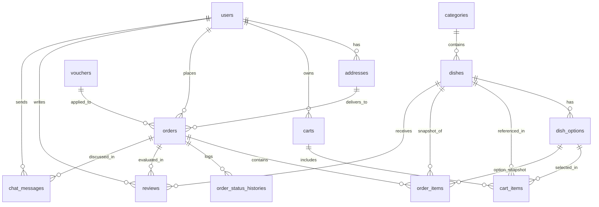

# Đặc Tả Module Thực Đơn & Tìm Kiếm + Ghép ERD Chung 13 Bảng (T3D1BA1)

## 1. Đặc tả chức năng Module Thực đơn & Tìm kiếm (Menu & Search)
- **Quản lý Danh mục (`categories`)**:
  - Thêm, sửa tên, sắp xếp thứ tự hiển thị (`sort_order`), ẩn/hiện danh mục (`is_active`).
  - Ràng buộc toàn vẹn: Không cho phép xóa danh mục khi đang còn món ăn thuộc danh mục đó.
- **Quản lý Món ăn & Tuỳ chọn (`dishes`, `dish_options`)**:
  - Quản lý thông tin món: tên, mô tả, giá bán (> 0), hình ảnh, trạng thái (`AVAILABLE`: Đang bán, `OUT_OF_STOCK`: Hết món, `HIDDEN`: Ẩn), đánh dấu món nổi bật (`is_featured`).
  - Quản lý nhóm tuỳ chọn (`option_group`: Size, Topping) với tên tuỳ chọn (`option_name`), giá cộng thêm (`extra_price`), bắt buộc hay không (`is_required`), chọn 1 hay nhiều (`max_select`).
  - Món ăn đã phát sinh trong đơn hàng (`order_items`) không được xoá vật lý mà chỉ chuyển sang trạng thái Ẩn (`HIDDEN` / `is_active = false`).
- **Menu khách & Tìm kiếm / Lọc**:
  - Hiển thị danh sách món đang bán theo danh mục (loại bỏ món ẩn và danh mục ẩn), món nổi bật, món bán chạy.
  - Tìm kiếm theo tên, lọc theo danh mục, khoảng giá, trạng thái còn bán; sắp xếp theo giá tăng/giảm, bán chạy, điểm đánh giá; phân trang.

## 2. Thiết kế bảng của Module
### Bảng `categories`
| Cột | Kiểu dữ liệu | Ràng buộc | Mô tả |
|---|---|---|---|
| `id` | `INT AUTO_INCREMENT` | `PRIMARY KEY` | Mã danh mục |
| `name` | `VARCHAR(100)` | `UNIQUE, NOT NULL` | Tên danh mục |
| `sort_order` | `INT` | `NOT NULL DEFAULT 0` | Thứ tự hiển thị |
| `is_active` | `BOOLEAN` | `NOT NULL DEFAULT TRUE` | Trạng thái hiển thị |

### Bảng `dishes`
| Cột | Kiểu dữ liệu | Ràng buộc | Mô tả |
|---|---|---|---|
| `id` | `INT AUTO_INCREMENT` | `PRIMARY KEY` | Mã món ăn |
| `category_id` | `INT` | `FOREIGN KEY -> categories(id)` | Danh mục món |
| `name` | `VARCHAR(150)` | `NOT NULL` | Tên món ăn |
| `description` | `TEXT` | `NULL` | Mô tả chi tiết |
| `price` | `INT` | `NOT NULL (> 0)` | Giá bán cơ bản (VND) |
| `image_url` | `VARCHAR(500)` | `NULL` | Đường dẫn ảnh món |
| `status` | `VARCHAR(20)` | `DEFAULT 'AVAILABLE'` | `AVAILABLE` / `OUT_OF_STOCK` / `HIDDEN` |
| `is_available` | `BOOLEAN` | `DEFAULT TRUE` | Cờ còn món trong ngày |
| `is_active` | `BOOLEAN` | `DEFAULT TRUE` | Cờ hiển thị (false = Ẩn) |
| `is_featured` | `BOOLEAN` | `DEFAULT FALSE` | Món nổi bật trang chủ |

### Bảng `dish_options`
| Cột | Kiểu dữ liệu | Ràng buộc | Mô tả |
|---|---|---|---|
| `id` | `INT AUTO_INCREMENT` | `PRIMARY KEY` | Mã tuỳ chọn |
| `dish_id` | `INT` | `FOREIGN KEY -> dishes(id)` | Món ăn sở hữu tuỳ chọn |
| `option_group` | `VARCHAR(50)` | `DEFAULT 'Topping'` | Nhóm tuỳ chọn (Size / Topping) |
| `option_name` | `VARCHAR(100)` | `NOT NULL` | Tên tuỳ chọn |
| `extra_price` | `INT` | `NOT NULL DEFAULT 0` | Giá cộng thêm (VND) |
| `is_required` | `BOOLEAN` | `DEFAULT FALSE` | Bắt buộc chọn hay không |
| `max_select` | `INT` | `DEFAULT 1` | Số lựa chọn tối đa trong nhóm |
| `is_active` | `BOOLEAN` | `DEFAULT TRUE` | Trạng thái tuỳ chọn |

## 3. Sơ đồ ERD Chung 13 Bảng của Nhóm
(`users`, `addresses`, `categories`, `dishes`, `dish_options`, `carts`, `cart_items`, `orders`, `order_items`, `order_status_histories`, `vouchers`, `reviews`, `chat_messages`)

